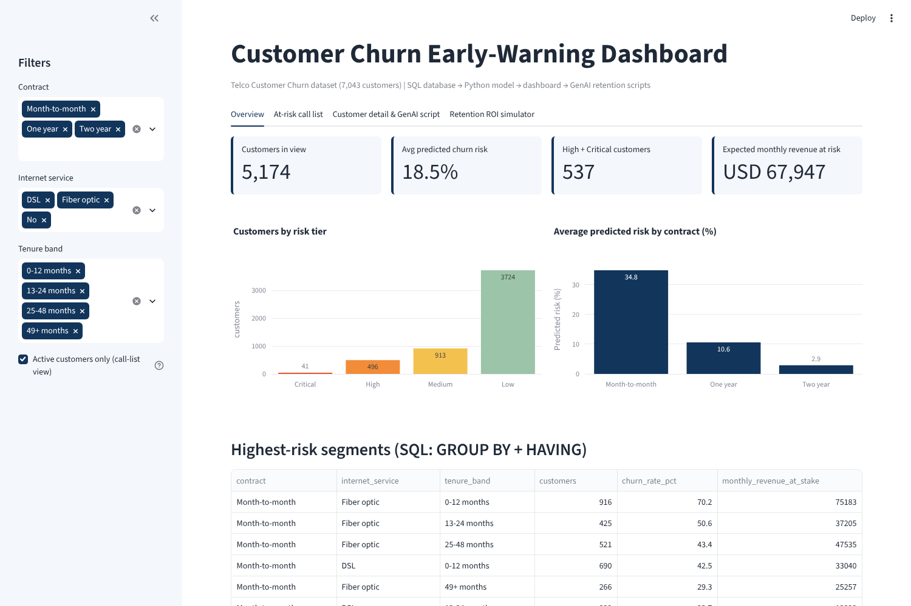
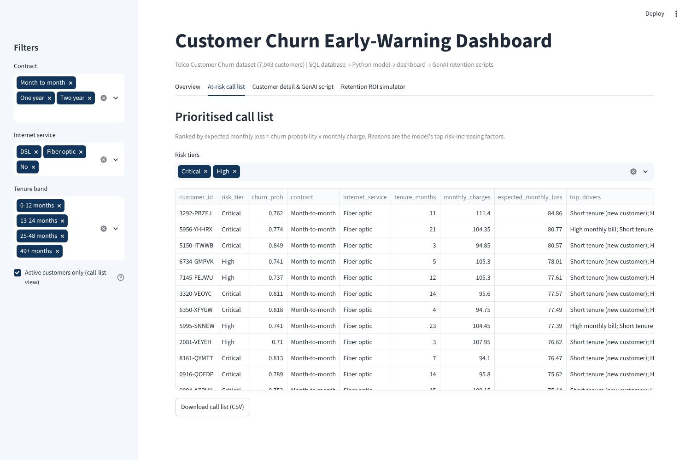
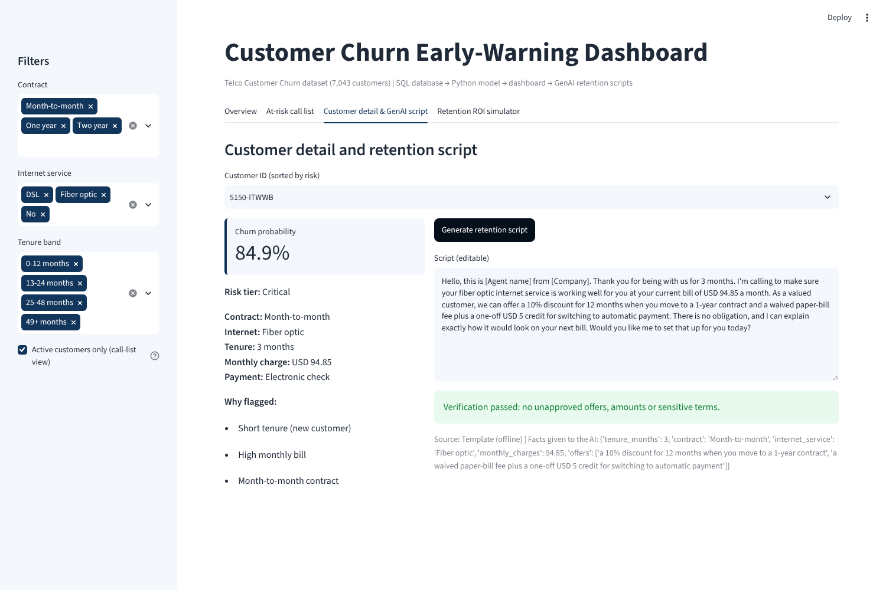
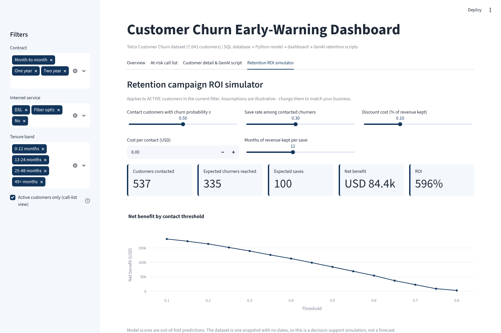

# Customer Churn Early-Warning Dashboard

**Data -> SQL database -> Python model -> Dashboard -> GenAI retention scripts -> Business insight**

A small but complete analytics workflow that tells a retention team *which customers are about to leave, why, and what to say to them* - before the cancellation happens.

| | |
|---|---|
| **Use case** | Churn risk - "Which groups have higher cancellation risk?" |
| **Target users** | Customer-success teams, call-centre agents and marketing staff of subscription businesses (telecom here; the same workflow transfers to banks and insurers) |
| **Decision supported** | Who to contact this week, with which approved offer, and whether the campaign pays back |
| **Data** | [Telco Customer Churn (Kaggle, IBM sample data)](https://www.kaggle.com/datasets/blastchar/telco-customer-churn) - 7,043 customers, 21 columns, 26.5% churned |

---

## Headline results

| Finding | Evidence |
|---|---|
| Contract type is the biggest lever | Month-to-month churn 42.7% vs 11.3% (1-year) vs 2.8% (2-year); month-to-month customers are 88.6% of all churners |
| Risk is front-loaded | 47.4% churn in the first 12 months vs 9.5% after 4 years |
| One segment is on fire | Month-to-month + fiber optic + first year: **70.2% churn** (916 customers) |
| Payment friction matters | Electronic-check payers churn 45.3% vs 15-19% for other methods |
| Add-ons are protective | Internet customers with Online Security + Tech Support: 9.0% churn vs 49.0% with neither |
| Model quality (out-of-sample) | ROC-AUC **0.845**, top-decile lift 2.8x; risk tiers behave as intended: Low 8.8%, Medium 35.1%, High 62.3%, Critical 82.7% actual churn |
| Business case (illustrative) | Contacting the 537 active High/Critical customers: ~USD 84k net benefit, ROI ~596% under stated assumptions |

---

## Architecture

```
 CSV (Kaggle)
    |  src/etl.py            clean (TotalCharges blanks), validate, row-count reconcile
    v
 SQLite  data/churn.db       customers | services | billing | churn_scores  + view v_customer_360
    |  sql/02_queries.sql    11 named queries: JOIN, GROUP BY, HAVING, CASE, CTE, window RANK()
    v
 Python  src/model.py        logistic regression (production) vs gradient boosting (challenger)
    |                        out-of-fold scores + plain-language "why flagged" written back to SQL
    v
 Dashboard app/dashboard.py  Streamlit: overview | call list | customer detail | ROI simulator
    |
    v
 GenAI   src/genai.py        LLM drafts a call script from approved facts + approved offers,
                             then a rule-based verifier checks it before an agent sees it
```

## Quick start

```bash
python -m venv .venv && source .venv/bin/activate     # Windows: .venv\Scripts\activate
pip install -r requirements.txt

python run_pipeline.py             # ETL -> database -> model -> SQL analysis + figures
streamlit run app/dashboard.py     # open http://localhost:8501
python -m pytest -q                # 7 tests: verifier + database integrity
```

**Optional - real LLM scripts.** Set `ANTHROPIC_API_KEY` (and optionally `ANTHROPIC_MODEL`) before launching the dashboard. Without a key the assistant uses a deterministic offline template, so everything still runs; every script goes through the same verifier either way.

## Repository layout

```
churn-early-warning/
|-- README.md
|-- requirements.txt
|-- run_pipeline.py            one-command pipeline
|-- data/raw/                  original Kaggle CSV (data/churn.db is generated, git-ignored)
|-- sql/
|   |-- 01_schema.sql          tables, constraints, indexes, v_customer_360 view
|   `-- 02_queries.sql         named analytical queries
|-- src/
|   |-- config.py              paths, risk tiers, ROI defaults, APPROVED offers
|   |-- etl.py                 load / clean / validate / build database
|   |-- db.py                  run named SQL queries
|   |-- model.py               train, evaluate, score, explain
|   |-- roi.py                 campaign ROI logic
|   |-- genai.py               prompt, generation, verification
|   `-- analysis.py            run queries, draw figures, write summary.json
|-- app/dashboard.py           Streamlit dashboard
|-- tests/test_verification.py
|-- outputs/                   metrics.json, summary.json, sql_results/*.csv, figures/*.png
`-- docs/                     final presentation (.pptx) and dashboard screenshots
```

## Dashboard

| Overview | Call list |
|---|---|
|  |  |
| **Customer detail + GenAI script** | **ROI simulator** |
|  |  |

What the user can interact with: sidebar filters (contract, internet service, tenure band, active-only), risk-tier selector, customer picker, a "Generate retention script" button, an editable script box, CSV export of the call list, and sliders for the ROI assumptions.

## Key design decisions (and why)

1. **Logistic regression in production.** Gradient boosting scored the same (hold-out ROC-AUC 0.844 vs 0.845), so we kept the model whose every prediction can be decomposed into reasons an agent can read.
2. **TotalCharges is not a feature.** It is roughly tenure x monthly charge, so it is redundant and made coefficients misleading. Removing it changed ROC-AUC by less than 0.002. The 11 blank values are all new customers (tenure = 0) and are stored as NULL, not guessed.
3. **gender is excluded**, and demographic traits (senior citizen, partner, dependents) are never shown as "reasons" or allowed in scripts.
4. **Out-of-fold scores.** Every customer is scored by a model that never saw them, so the back-test table is honest.
5. **Call list and ROI use active customers only** - you cannot save a customer who has already left. Already-churned customers are used only for the back-test.

## How AI output is verified

| Risk | Control |
|---|---|
| Invented discounts / prices | Every currency amount, percentage and duration in the script must match the customer's real bill, tenure or the approved offer list in `config.py` |
| Sensitive or creepy wording | Forbidden-term check (churn, probability, age, gender, family status, ...) |
| Off-brief output | Length 60-150 words, must mention an approved offer, must end with a question |
| LLM misbehaves or is offline | Failed LLM output is replaced by the template and flagged; the dashboard shows "Verification passed" or "Needs human review" |
| Our own mistakes | `tests/test_verification.py` feeds the verifier bad scripts (50% discount, "senior customer", no call to action) and asserts they are rejected; all 7,043 template scripts pass |

The model's numbers are verified separately: row counts reconcile at every ETL step, the score table must cover every customer with probabilities in [0, 1], and the report/slides read every figure from `outputs/summary.json` and `outputs/sql_results/`.

## Limitations

- The dataset is a single snapshot with no dates, so scores indicate *relative* risk and the ROI tab is a decision-support simulation, not a forecast. Save rate, contact cost and months of revenue kept are assumptions - edit them in the dashboard.
- Active customers have by definition not churned yet; their predicted probabilities are treated as forward-looking risk.
- Customers cannot be contacted by name here (the dataset is anonymised); scripts use placeholders for the agent's name and company.
- Telco churn is a proxy for bank/insurer churn; behavioural drivers (contract, tenure, payment method) transfer, but offers and thresholds must be re-calibrated on the institution's own data.

## Next steps

Time-stamped data to forecast churn in the next 30 days; A/B-test the scripts against a control group to measure the real save rate; add an uplift model (who is *persuadable*, not just who is at risk); connect to the CRM so the call list refreshes nightly.
